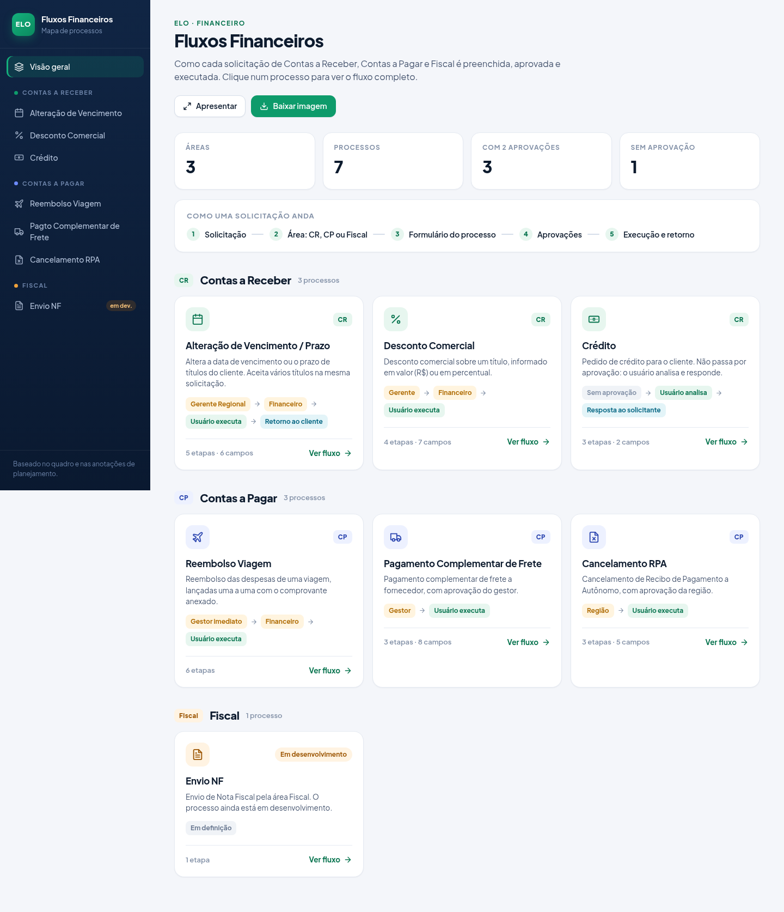
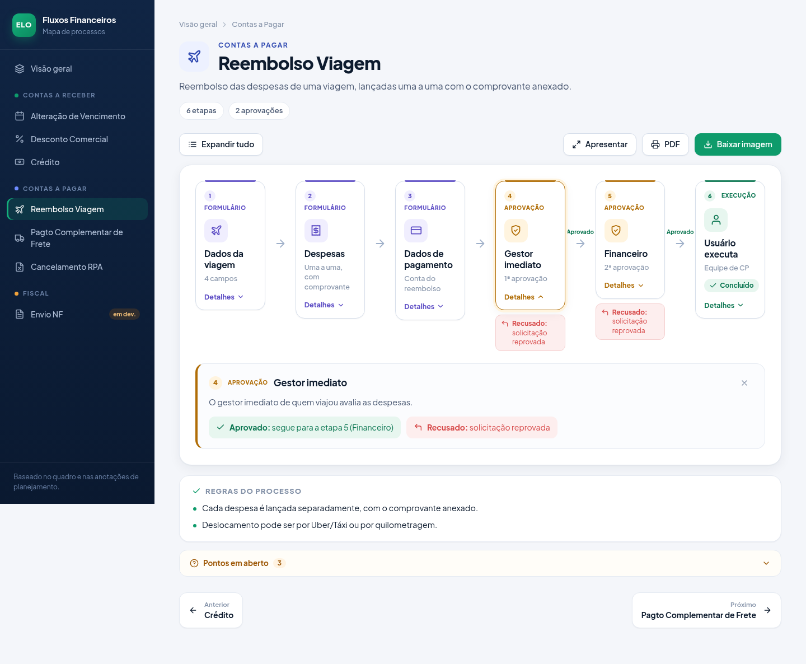

# Fluxograma Financeiro — ELO

Fluxogramas dos processos financeiros da ELO, extraídos dos quadros de planejamento e
formalizados em [Mermaid](https://mermaid.js.org/). Os diagramas renderizam diretamente no GitHub.

## Legenda de siglas

| Sigla | Significado |
|-------|-------------|
| **CR** | Contas a Receber |
| **CP** | Contas a Pagar |
| **RPA** | Recibo de Pagamento a Autônomo |
| **NF** | Nota Fiscal |
| **CTE** | Conhecimento de Transporte Eletrônico |

## Processos mapeados

| Processo | Área | Aprovações |
|----------|------|------------|
| [Visão geral](fluxogramas/00-visao-geral.md) | — | — |
| [Alteração de Vencimento / Prazo](fluxogramas/01-alteracao-vencimento.md) | CR | Gerente Regional → Financeiro |
| [Desconto Comercial](fluxogramas/02-desconto-credito.md) | CR | Gerente → Financeiro |
| [Crédito](fluxogramas/07-credito.md) | CR | sem aprovação |
| [Reembolso Viagem](fluxogramas/03-reembolso-viagem.md) | CP | Gestor imediato → Financeiro |
| [Pagamento Complementar de Frete](fluxogramas/04-solicitacao-pagamento.md) | CP | Gestor |
| [Cancelamento RPA](fluxogramas/05-cancelamento-rpa.md) | CP | Região |
| [Envio NF](fluxogramas/06-envio-nf.md) | Fiscal | em desenvolvimento |

## Dashboard

**https://elofavoritos-glitch.github.io/fluxograma-financeiro-elo/dashboard/**

- Clique numa etapa para ver os campos e as regras. **Expandir tudo** abre todas.
- **Apresentar** abre em tela cheia; as setas ← → trocam de processo.
- **Baixar imagem** gera um PNG em alta resolução (3x), com todas as etapas abertas. **PDF** imprime o processo.

## Dúvidas pendentes (rever depois)

- [ ] **Reembolso Viagem:** a seta que volta do fim para o início significa "adicionar mais despesas"?
- [ ] **Reembolso Viagem:** em "Dados de pagamento (PIX / CC / ...)", qual é a terceira opção?
- [ ] **Alteração de Vencimento (Cadastro):** o que vem depois de "Usuário executa" (anotação parecida com "OK por aviso")?
- [ ] **Desconto, Reembolso, Pagto Complementar e Cancelamento RPA:** as anotações não dizem o que acontece na reprovação. Hoje está "Reprovado". Deve voltar ao solicitante, como na Alteração?

> Os fluxogramas foram interpretados a partir das fotos do quadro e das anotações do caderno. Alguns campos
> podem precisar de ajuste fino — revise e me avise as correções.
