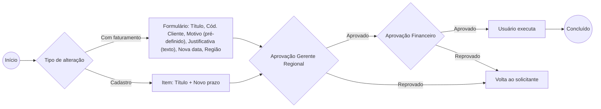

# Alteração de Vencimento / Prazo (CR)

Dois caminhos: **com faturamento** (formulário completo) ou **cadastro** (item: título + novo prazo, mesmo fluxo).
Se reprovada em qualquer alçada, volta ao solicitante.

> Anotação: prever mais de um título por solicitação.

