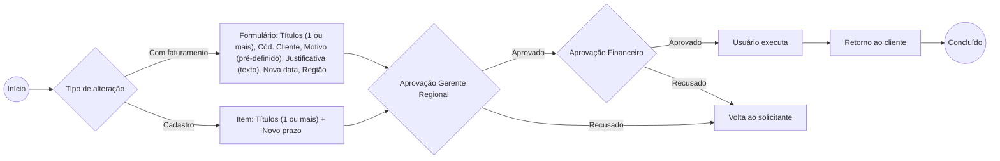

# Alteração de Vencimento / Prazo (CR)

Dois caminhos: **com faturamento** (formulário completo) ou **cadastro** (títulos + novo prazo, mesmo fluxo).
Aceita **vários títulos na mesma solicitação**.
Se recusada em qualquer alçada, volta ao solicitante. Se aprovada, o retorno vai para o cliente.

