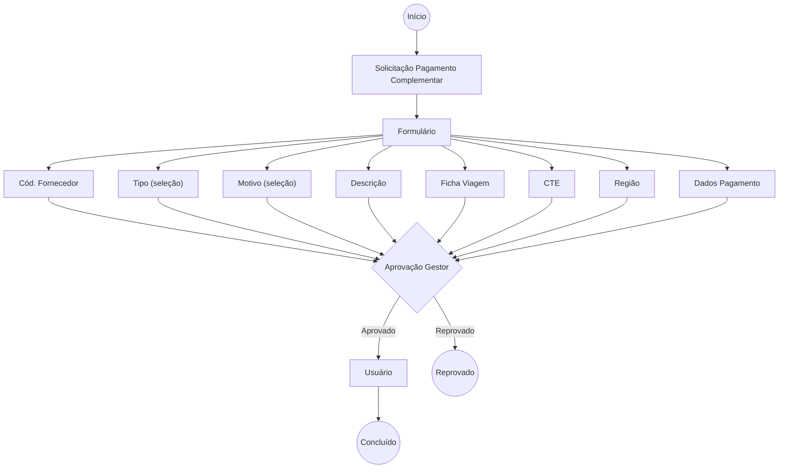

# Solicitação de Pagamento Complementar — CP

Solicitação de pagamento complementar (Contas a Pagar). Usa o mesmo formulário
de Reembolso Viagem e Cancelamento RPA, com aprovação do gestor antes da execução.

