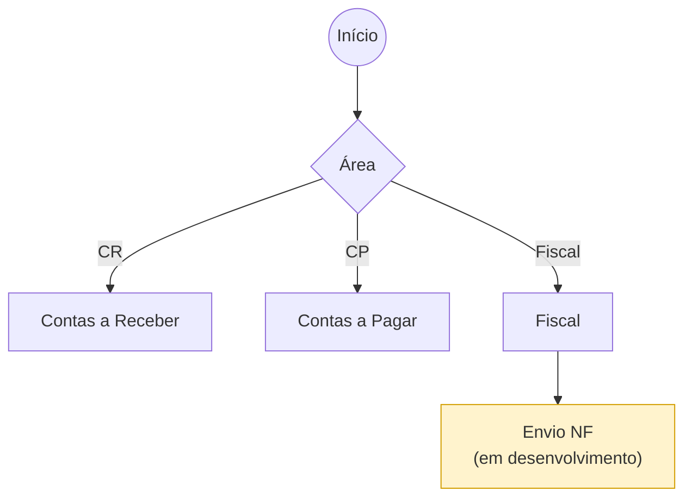

# Envio NF — Fiscal (em desenvolvimento)

Envio de Nota Fiscal pela área Fiscal. Fluxo ainda **em desenvolvimento** —
mapeamento preliminar a partir do quadro.

> **Pendente:** detalhar campos e trilha de aprovação do Envio NF quando o processo for definido.
